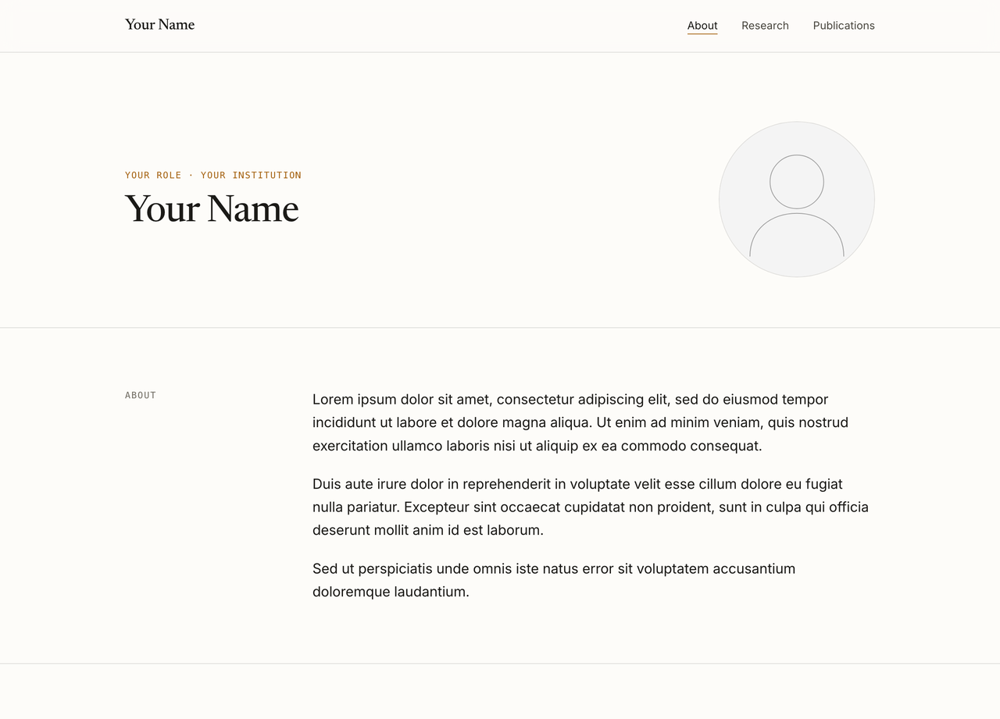

# Academic website template

A personal website template for researchers: plain HTML and CSS, no build
step, no packages, free hosting on GitHub Pages. It includes Markdown workflows
that an AI coding agent can follow to
fill in your content, verify your publication list, check the layout, and
deploy the site.

Adapted from [joshtycko.com](https://joshtycko.com).



## Features

- A homepage (name, role, photo, about, research interests, selected papers)
  and a full publications page with a numbered list, filter chips (Selected,
  Research, Reviews, Protocols, Preprints), Patents and Other writing sections,
  and a sticky section index.
- Automatic dark mode, responsive layout, reduced-motion support, and an email
  link that is not stored as plain text in the page.
- Self-hosted open-license fonts. No third-party requests, no cookies.
- Search and sharing basics: structured data describing you, a sitemap and
  robots.txt, and link previews (your photo, name, and affiliation) for when
  your site is shared.
  All content is plain HTML and readable with JavaScript off.

## Quick start with a coding agent

1. Click **Use this template → Create a new repository** on GitHub, or clone
   this repo, and open the folder in your coding agent.
2. Ask it to set up your website.

Or give the agent the link directly:

> Clone https://github.com/JoshTycko/academic-website-template into a new folder
> called `my-website`, read its AGENTS.md, and set up my academic website.

### Workflows (`.claude/skills/`)

Each is a plain Markdown file. Claude Code loads them as skills automatically;
other agents read them through [`AGENTS.md`](AGENTS.md).

| Workflow | What it does |
|---|---|
| `setup-site` | Replaces every placeholder: bio, interests, links, photo, email, and a publication list checked against Crossref, PubMed, or ORCID |
| `add-publications` | Finds new papers, preprints that have since been published, press coverage, and patent updates, and verifies each before adding it |
| `visual-check` | Screenshots every page on desktop and phone, in light and dark mode, for inspection |
| `deploy-site` | Publishes on GitHub Pages, with optional custom-domain DNS and HTTPS steps |

The publication workflows require every citation, press link, and patent status
to be checked against a real source.

## Editing by hand

Every placeholder is plain text in `index.html` and `publications.html`. The
"Where to edit what" table in [`AGENTS.md`](AGENTS.md) maps each part of the
site to its file. Preview locally with:

```bash
python3 -m http.server 8000
```

then open <http://localhost:8000>. Helper scripts in `tools/`:

- `check.py` checks tag balance and the publication countdown, confirms the
  Selected papers match across pages, and lists leftover placeholders
  (`--renumber` fixes the countdown).
- `encode-email.py` encodes your email address for the footer link.
- `make-og-image.py` renders a name-and-role preview card, for sites without
  a headshot.
- `screenshots.sh` takes 12 screenshots (3 pages × desktop/phone × light/dark)
  with headless Chrome.

`snippets/social-icons.html` has extra footer icons (Bluesky, GitHub, Mastodon,
website) ready to paste in.

## Deploying

Name the repository `YOUR-USERNAME.github.io`, push it, and turn on Pages. The
site serves at `https://YOUR-USERNAME.github.io/`, and every later `git push`
redeploys it. The `deploy-site` workflow covers this and custom domains.

## License

Code: MIT (see [`LICENSE`](LICENSE)). Fonts: [Newsreader](https://github.com/productiontype/Newsreader)
and [Inter](https://github.com/rsms/inter), both under the SIL Open Font License
1.1 (see `fonts/`).
